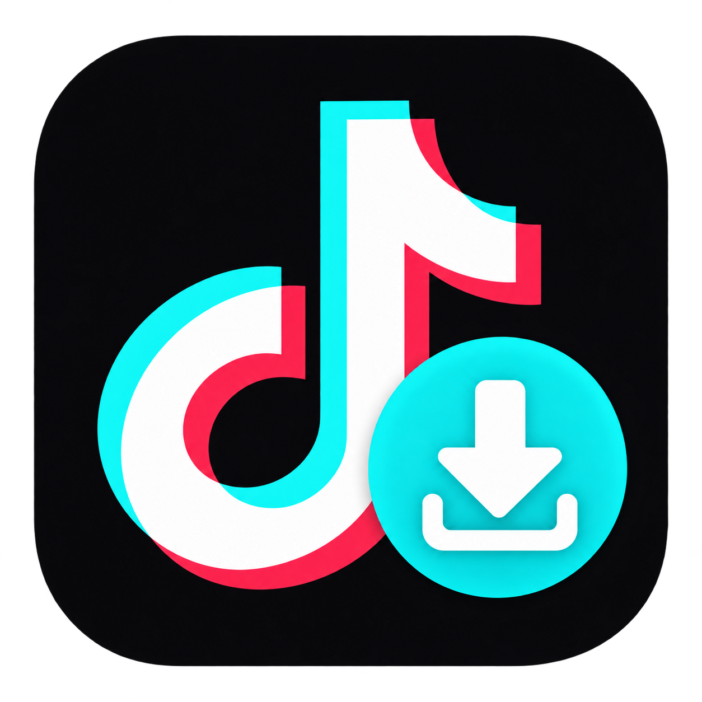

<p align="center"></p>

# TikTok 视频采集器

**1.0 · Windows 桌面工具**

按点赞、评论、收藏和视频时长筛选 TikTok 公开视频，批量下载并集中管理本地视频。支持推荐流采集、单链接下载和作者主页下载。

程序通过本机 Microsoft Edge 浏览网页，使用 SaveSora 解析下载链接。

## 当前功能

- 浏览公开推荐流，按互动指标及视频时长上下限筛选内容。
- 支持单个视频链接下载，以及作者主页已加载作品的滚动采集与下载。
- 支持 1–4 个并行下载任务，按每批成功数量暂停并确认是否继续。
- 提供下载总时限、可观测无进展时限和文件大小上限设置。
- 按视频 ID 去重，校验文件及实际时长，保存下载记录和分类信息。
- 视频库支持关键词、日期、大小和时长筛选，以及播放、打开目录和记录管理。
- 提供结构化运行日志及诊断日志导出。

## 安装与运行

### 使用 Windows 程序

在 [Releases](https://github.com/Logic-DH-0421/tiktok-video-collector/releases/latest) 下载 `TikTokVideoCollector-v1.0-windows-x64.zip`，解压后运行 `TikTokVideoCollector-v1.0.exe`。

运行环境：Windows 10/11（64 位），已安装 Microsoft Edge。EXE 已包含 Python 运行时。

### 从源码运行

需要 Python 3.12（64 位，含 Tcl/Tk）和 Microsoft Edge。在项目根目录打开 PowerShell：

```powershell
python -m venv .venv
.\.venv\Scripts\python.exe -m pip install -r requirements.txt
.\.venv\Scripts\python.exe app.py
```

## 使用步骤

1. 打开下载设置，选择视频保存目录。
2. 设置最低点赞、评论、收藏数、视频时长范围、并行数和每批成功数量。
3. 开始自动采集，在下载队列和视频列表中查看任务状态。
4. 每批达到设定的成功数量后，选择继续或结束采集。
5. 单个视频或作者主页可通过左侧对应入口添加下载任务。
6. 在视频库中查询、播放、分类或打开已下载文件所在目录。

自动采集的互动指标和时长条件用于推荐流筛选。单链接和作者主页下载按各自入口提交任务。

## 数据与隐私

- 数据目录：`%LOCALAPPDATA%\TikTokVideoCollector`，用于保存配置、SQLite 数据库、独立浏览器资料和运行日志。
- 视频保存在下载设置指定的目录。升级时会继续使用已有应用数据，建议提前备份数据目录。
- 浏览器资料可能包含登录状态。分享诊断信息时，请使用软件提供的日志导出功能，并检查其中的个人信息。
- 清空列表会移除数据库记录并保留已下载文件；删除文件操作以界面提示为准。

## 常见问题

**下载速度较慢或任务超时怎么办？**

检查网络连接和解析服务状态，并按文件大小调整下载总时限。默认总时限为 7200 秒，可观测无进展时限为 180 秒，最大文件大小设为 0 时表示不限。进度信息取决于浏览器提供的数据。

**遇到登录或验证码怎么办？**

按软件提示切换到对应页面完成验证，再返回程序继续任务。网站可用性受地区、账号权限和页面更新影响。

**为什么实际时长与网页显示不同？**

网页时长可能经过取整。程序下载后按文件的实际时长复核筛选条件。

## 开发与构建

```powershell
.\.venv\Scripts\python.exe -m pip install -r requirements-build.txt
.\.venv\Scripts\python.exe -m unittest discover -v
.\.venv\Scripts\python.exe build.py
```

构建输出：`dist/TikTokVideoCollector-v1.0.exe`。测试覆盖筛选规则、队列、下载生命周期、日志和界面逻辑；浏览器集成测试需要 Microsoft Edge。外部网站的可用性需在相应网络和账号环境下确认。

## 反馈

通过 [Issues](https://github.com/Logic-DH-0421/tiktok-video-collector/issues) 报告问题时，请提供软件版本、Windows 版本、操作步骤和脱敏后的错误信息。

## 版权与第三方资源

Copyright © 2026 Logic。项目代码保留所有权利。第三方组件许可与标识说明见 [THIRD_PARTY_NOTICES.md](THIRD_PARTY_NOTICES.md)。

请在获得相应授权的范围内保存和使用视频内容。
